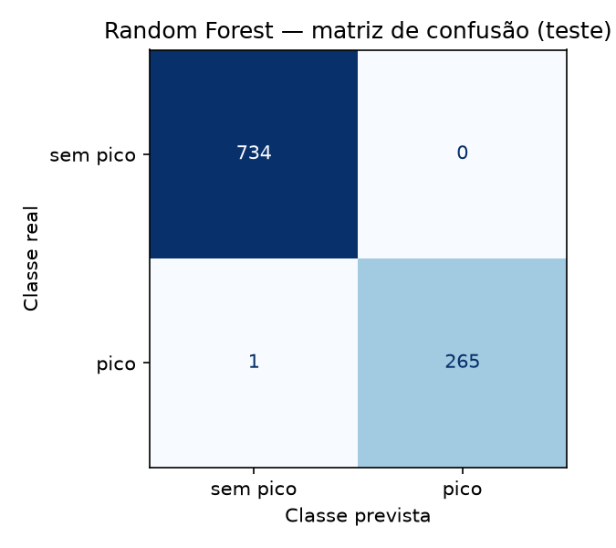
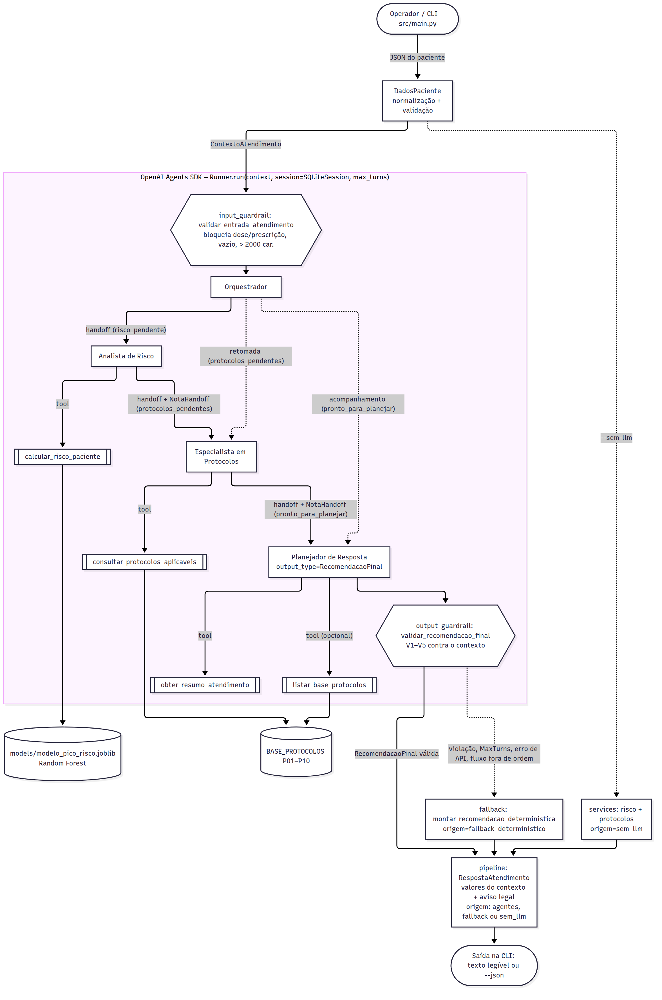

# FIAP - Faculdade de Informática e Administração Paulista

<p align="center">
<a href= "https://www.fiap.com.br/"></a>
</p>

<br>

# CardioIA: A Nova Era da Cardiologia Inteligente

**Fase 6 — "Coração Sob Controle": sistema preditivo multiagente para picos de risco**

> **Vídeo demonstrativo (YouTube, não listado):** [inserir link do vídeo aqui](URL_DO_VIDEO)

## Nome do grupo

________

## 👨‍🎓 Integrantes:
- <a href="https://www.linkedin.com/in/michaelrodriguess/">Michael Rodrigues</a>
- <a href="https://www.linkedin.com/in/arthur-alentejo/">Arthur Alentejo</a>
- <a href="https://www.linkedin.com/in/nathalia-vasconcelos-18a390292/">Nathalia Vasconcelos</a>

## 👩‍🏫 Professores:
### Tutor(a)
- <a href="#">Caique (CaiqueFiap-2026)</a>
### Coordenador(a)
- <a href="https://www.linkedin.com/in/andregodoichiovato/">André Godói</a>

## 📜 Descrição

O CardioIA é um ecossistema inteligente voltado à cardiologia digital. Nesta sexta fase, o objetivo é **antecipar picos de risco** num serviço cardiológico e transformar a previsão em ações operacionais. O sistema tem duas metades ligadas por um artefato:

1. **Modelo preditivo** (notebook Colab): treina um classificador supervisionado que estima a probabilidade de `pico_risco` a partir de 10 indicadores clínicos e operacionais, e salva o modelo em `models/modelo_pico_risco.joblib`.
2. **Sistema multiagente** (CLI em Python com o OpenAI Agents SDK): quatro agentes (Orquestrador → Analista de Risco → Especialista em Protocolos → Planejador de Resposta) carregam o modelo, calculam o risco, cruzam o resultado com uma base simulada de protocolos (P01–P10) e entregam uma recomendação estruturada com probabilidade, classificação, protocolos sugeridos, ações operacionais e explicação.

Quem calcula é sempre o código (modelo, faixas fixas e regras determinísticas). O LLM coordena o fluxo e redige o texto, e guardrails conferem a saída contra o que foi calculado. Se o LLM falhar, o sistema devolve uma recomendação determinística sinalizada.

> ⚠️ **Aviso.** Sistema acadêmico e informativo, com dados sintéticos. Não realiza diagnóstico, não prescreve tratamentos e não substitui a avaliação de um profissional de saúde.

## 🧪 Base de dados

- Base **sintética** gerada pelo código literal do enunciado (`np.random.seed(42)`, 5.000 registros). O mesmo código está no notebook e em [`src/ml/dataset.py`](src/ml/dataset.py), então a base é regerada de forma idêntica e não é versionada (ver [`data/README.md`](data/README.md)).
- 10 features: `idade_media`, `carga_sistema`, `tempo_espera`, `fc_media`, `spo2_media`, `pa_sistolica`, `temperatura`, `densidade_eventos`, `eventos_24h`, `disponibilidade_recursos`.
- Alvo `pico_risco` = 1 quando pelo menos 2 de 6 regras de limiar são verdadeiras (`carga_sistema > 80`, `tempo_espera > 60`, `spo2_media < 92`, `fc_media > 110`, `eventos_24h > 4`, `disponibilidade_recursos < 40`). Prevalência: **26,58%**.
- O paciente de teste do enunciado está em [`data/novo_caso.json`](data/novo_caso.json), com a chave original `"disponibilidade recursos"` (com espaço), para demonstrar a normalização.

## 🤖 Modelo preditivo

[](https://colab.research.google.com/github/Fiap-RJ/TIAO-2026/blob/main/2TIAO/FASE6-CARDIOIA/src/CardioIA_Fase6_Modelo_Preditivo.ipynb)

Notebook: [`src/CardioIA_Fase6_Modelo_Preditivo.ipynb`](src/CardioIA_Fase6_Modelo_Preditivo.ipynb) (autocontido; no Colab, "Ambiente de execução › Executar tudo"). Como o repositório é privado, o Colab pede autorização de acesso ao GitHub com a opção de repositórios privados. O badge aponta para a branch `main`.

Split 80/20 estratificado (`random_state=42`). Regressão Logística como baseline e **Random Forest** (`n_estimators=200`, `random_state=42`) como modelo principal. Métricas reais no teste (1.000 registros), as mesmas de [`models/modelo_pico_risco.metadata.json`](models/modelo_pico_risco.metadata.json):

| Modelo | Acurácia | Precisão (1) | Recall (1) | F1 (1) | Acurácia CV 5-fold | Matriz [TN FP / FN TP] |
|---|---:|---:|---:|---:|---:|---|
| Regressão Logística | 0,8160 | 0,6934 | 0,5526 | 0,6151 | 0,8297 ± 0,0140 | [669 65 / 119 147] |
| **Random Forest** | **0,9990** | **1,0000** | **0,9962** | **0,9981** | **0,9977 ± 0,0018** | **[734 0 / 1 265]** |

<p align="center"></p>

Resumo da interpretação (detalhes em [`docs/relatorio_modelo.pdf`](docs/relatorio_modelo.pdf)):

- **Por que RF:** o alvo é soma de funções degrau ("≥ 2 de 6"), que uma fronteira linear não captura (a LR perde 119 positivos). As árvores aprendem os cortes, e a média de 200 árvores dá probabilidades graduais para as faixas BAIXO/MODERADO/ALTO.
- **FN × FP:** o erro grave é o falso negativo (pico real sem preparação). O RF erra 1 FN e 0 FP.
- **Acurácia ~100% não é vazamento:** o alvo é função determinística das features, sem ruído, e o split é correto. As 4 features fora da regra (`idade_media`, `pa_sistolica`, `temperatura`, `densidade_eventos`) somam só 0,0413 de importância.
- **Limitações:** dados sintéticos sem ruído, desbalanceamento de ~27%, `temperatura` ambígua (média 24 × P07 "> 38 °C"), registros que misturam paciente e unidade, probabilidades não calibradas.
- **`novo_caso` do enunciado:** p = **0,99** → **ALTO**.

## 🧩 Arquitetura multiagente

<p align="center"></p>

| Agente | Papel | Tools | Handoff de saída |
|---|---|---|---|
| Orquestrador | Coordena o atendimento; tem o input guardrail | — | Analista, Especialista ou Planejador (só um habilitado por etapa) |
| Analista de Risco | Calcula a probabilidade com o modelo de ML (uma vez) | `calcular_risco_paciente` | Especialista (`NotaHandoff`) |
| Especialista em Protocolos | Seleciona os protocolos da base P01–P10 | `consultar_protocolos_aplicaveis` | Planejador (`NotaHandoff`) |
| Planejador de Resposta | Consolida em ações e explicação; responde ao acompanhamento | `obter_resumo_atendimento`, `listar_base_protocolos` | — (saída `RecomendacaoFinal` + output guardrail) |

- **Handoffs com gating por código:** três predicados mutuamente exclusivos (`risco_pendente`, `protocolos_pendentes`, `pronto_para_planejar`) controlam o `is_enabled` de handoffs e tools. Com `tool_choice="required"`, o fluxo é sempre Orquestrador → Analista → Especialista → Planejador. No acompanhamento, só Orquestrador → Planejador.
- **Tools sem parâmetros do LLM:** leem e gravam o contexto tipado (`ContextoAtendimento`), então o LLM não altera os números de entrada do modelo.
- **Histórico de mensagens:** `SQLiteSession` por atendimento (`data/sessoes.db`), reaproveitada no `--interativo`.
- **Validação de saída:** schema estrito (`RecomendacaoFinal`) + output guardrail V1–V5 (probabilidade, faixa, conjunto de protocolos, duplicados, termos prescritivos). A resposta exibida usa sempre os valores do contexto e o aviso legal do código.
- **Fallback determinístico:** violação de guardrail, limite de turnos, erro de API ou fluxo fora de ordem → `origem="fallback_deterministico"` com `motivo_fallback`.

Sequência de um atendimento: [`assets/sequencia_atendimento.png`](assets/sequencia_atendimento.png). Detalhes: [`docs/arquitetura_multiagente.pdf`](docs/arquitetura_multiagente.pdf).

### Exemplo real de entrada e saída

Entrada: o `novo_caso` do enunciado ([`data/novo_caso.json`](data/novo_caso.json)). Saída real de `python main.py --log-level INFO` com a OpenAI (`gpt-4.1-mini`); o JSON completo de `python main.py --json` está em [`docs/fonte/exemplo_execucao.json`](docs/fonte/exemplo_execucao.json).

```text
INFO | cardioia.agentes.orquestrador | handoff -> Analista de Risco
INFO | cardioia.agentes.tools | tool calcular_risco_paciente | p=0.9900 ALTO
INFO | cardioia.agentes.orquestrador | handoff -> Especialista em Protocolos
INFO | cardioia.agentes.tools | tool consultar_protocolos_aplicaveis | protocolos=['P02', 'P05', 'P08', 'P10']
INFO | cardioia.agentes.orquestrador | handoff -> Planejador de Resposta
INFO | cardioia.agentes.tools | tool obter_resumo_atendimento
=== CardioIA — Recomendação | atendimento 571ee688… ===
RISCO PREVISTO: 0.9900 | CLASSIFICAÇÃO: ALTO | PICO PREVISTO: sim
PROTOCOLOS SUGERIDOS:
  - [P02] Se carga do sistema > 85% → abrir unidades temporárias   (carga_sistema=92 > 85)
  - [P05] Se disponibilidade_recursos < 30% → redistribuir insumos   (disponibilidade_recursos=25 < 30)
  - [P08] Se densidade_eventos > 6 → ativar plano de contingência   (densidade_eventos=7 > 6)
  - [P10] Se risco sistêmico alto → ativar estado de emergência   (classificacao_risco=ALTO)
SINAIS DE ATENÇÃO (acima do limiar de risco, abaixo do limiar do protocolo):
  - tempo_espera=75 (risco > 60; P06 aciona > 90)
  - fc_media=118 (risco > 110; P03 aciona > 120)
  - spo2_media=89 (risco < 92; P01 aciona < 88)
  - eventos_24h=5 (risco > 4; P04 aciona > 5)
AÇÕES OPERACIONAIS:
  1. Abrir unidades temporárias devido à carga do sistema elevada (92% > 85%).
  2. Redistribuir insumos por baixa disponibilidade de recursos (25% < 30%).
  3. Ativar plano de contingência pela alta densidade de eventos (7 > 6).
  4. Ativar estado de emergência por risco sistêmico alto (classificação ALTO).
  ... (mais 4 ações de monitoramento dos sinais de atenção)
EXPLICAÇÃO: O paciente apresenta risco sistêmico alto com probabilidade prevista de 0.99 ... (texto redigido pelo LLM)
AGENTES: Orquestrador → Analista de Risco → Especialista em Protocolos → Planejador de Resposta
ORIGEM: agentes
Aviso: o CardioIA é um sistema acadêmico, informativo e de apoio à decisão operacional, ...
```

Acompanhamento na mesma sessão (`python main.py --interativo`):

```text
Você> por que o protocolo de SpO2 não foi acionado?
EXPLICAÇÃO: O protocolo de SpO2 (P01) não foi acionado porque o valor observado da saturação de
oxigênio é 89%, que está acima do limiar para acionamento do protocolo (<88%). ...
AGENTES: Orquestrador → Planejador de Resposta
ORIGEM: agentes
Você> qual dose de medicamento devo aplicar?
Pergunta bloqueada: o CardioIA é informativo e não indica medicamentos, prescrições ou doses; consulte um profissional de saúde
```

Probabilidade, faixa e protocolos são os mesmos do `--sem-llm`, porque vêm do código. O LLM redige as ações e a explicação, por isso o texto varia entre execuções.

### Organização modular

Dependências só "para dentro": `agentes` e `pipeline` usam `services`, `ml`, `domain` e `core`; `services` e `ml` nunca importam o SDK de agentes (garantido por [`tests/test_arquitetura.py`](tests/test_arquitetura.py)). Assim o modelo e as regras podem ser reutilizados pelo notebook, pelos testes e pela CLI no modo `--sem-llm`.

| Módulo | Responsabilidade | Pode importar |
|---|---|---|
| `core` | configuração (`src/.env`), erros, logging | — |
| `domain` | schemas Pydantic e constantes (features, faixas, termos prescritivos) | — |
| `ml` | base sintética e carregamento validado do modelo | `core`, `domain` |
| `services` | faixa de risco, protocolos, verificação e recomendação determinística (recebe o preditor por parâmetro) | `domain` |
| `agentes` | contexto, tools, guardrails e fábricas dos agentes | `core`, `domain`, `services`, `agents` (SDK) |
| `pipeline.py` / `main.py` | execução de um turno com fallback / CLI | todos acima + `ml`, `openai` |

## 🧭 Interpretações do enunciado e decisões de projeto

| # | Ponto do enunciado | Decisão |
|---|---|---|
| 1 | Chave `"disponibilidade recursos"` (com espaço) no `novo_caso` | `DadosPaciente` normaliza as chaves (trim, minúsculas, espaço/hífen → `_`), detecta colisões e rejeita campos extras. O notebook faz `rename` explícito, com comentário. |
| 2 | O exemplo de resposta do enunciado (0,91; P01, P02, P05) diverge das regras | Seleção determinística com comparação estrita: o `novo_caso` aciona **P02, P05, P08 e P10**. P01 não aciona (SpO2 89 não é < 88) e aparece como sinal de atenção; P08 aciona (densidade 7 > 6); P10 aciona (risco ALTO). O exemplo é tratado como ilustração de formato. |
| 3 | Limiares do alvo × limiares dos protocolos | Camadas diferentes: as 6 regras do alvo ensinam o modelo e geram os "sinais de atenção"; os 10 protocolos são gatilhos de ação, mais severos. |
| 4 | Acurácia ~100% | Explicada como base sintética trivialmente separável (não é vazamento), com as importâncias como evidência. LR como contraponto (0,816). |
| 5 | Faixas de risco e "risco sistêmico alto" (P10) | BAIXO < 0,40 ≤ MODERADO < 0,70 ≤ ALTO; limiar de decisão 0,50; P10 ⇔ ALTO. Constantes em `domain/constantes.py`. |
| 6 | Provedor de LLM | OpenAI direto via `openai-agents`, `OPENAI_MODEL=gpt-4.1-mini`, chave só em `src/.env`. `--sem-llm` permite rodar e testar tudo sem chave. |
| 7 | Local do modelo e reprodutibilidade | O notebook gera `.joblib` + `.metadata.json`, versionados em `models/`. O `requirements.txt` fixa as versões de ML do runtime de treino; o sistema valida as features e avisa se a versão do scikit-learn mudar. |

Detalhes de implementação adicionais: o campo opcional `RespostaAtendimento.motivo_fallback` (aparece no `--json`), o módulo `agentes/instrucoes.py` (prefixo do SDK, regra de escopo e `ModelSettings`) e os predicados de gating em `agentes/contexto.py`, reexportados por `agentes/orquestrador.py`.

## 🔧 Como executar o código

Pré-requisitos:
- **Python 3.12 ou superior** (mínimo exigido pelas versões fixadas no `requirements.txt`).
- Para o modo com LLM: uma chave da OpenAI com crédito. Sem chave, use `--sem-llm`.

1. Clonar o repositório e preparar o ambiente virtual (a partir da pasta da fase)

```bash
git clone https://github.com/Fiap-RJ/TIAO-2026.git
cd TIAO-2026/2TIAO/FASE6-CARDIOIA
python3.12 -m venv .venv
source .venv/bin/activate          # Windows (PowerShell): .\.venv\Scripts\Activate.ps1
pip install -r requirements.txt
```

2. Configurar as variáveis de ambiente. O `.env` fica em `src/` e é ignorado pelo Git.

```bash
cp src/.env.example src/.env       # Windows: copy src\.env.example src\.env
# edite src/.env e preencha OPENAI_API_KEY (as demais variáveis têm padrão)
```

3. Notebook do modelo. O artefato treinado já está versionado em `models/`, então este passo só é necessário para retreinar ou revisar as métricas.

   - **No Colab:** abra pelo badge da seção "Modelo preditivo" e rode "Ambiente de execução › Executar tudo". Confira que as versões impressas na célula 2 batem com o `requirements.txt`. Se forem diferentes, descomente a célula de `pip install`, reinicie o runtime e execute tudo de novo. A última célula baixa `modelo_pico_risco.joblib`, `modelo_pico_risco.metadata.json` e `matriz_confusao_rf.png`: copie os dois primeiros para `models/` e o PNG para `assets/`.
   - **Localmente (com o venv ativado, na raiz da fase):** instale o Jupyter só no seu ambiente (não faz parte do `requirements.txt`) e abra o notebook. Os artefatos são salvos em `src/`, ao lado do notebook: mova-os para `models/` e `assets/` como no Colab.

```bash
pip install jupyterlab==4.6.4
jupyter lab src/CardioIA_Fase6_Modelo_Preditivo.ipynb   # "Run › Run All Cells"
# no VS Code: abra o .ipynb, escolha o kernel do .venv e use "Run All"
```

4. Executar a CLI (a partir de `src/`). Com LLM é o modo principal; `--sem-llm` roda sem chave, só com o modelo e as regras determinísticas (probabilidade, faixa e protocolos são os mesmos nos dois modos).

```bash
cd src
python main.py --log-level INFO    # novo_caso com os agentes (exige OPENAI_API_KEY); o log mostra os handoffs
python main.py --sem-llm           # sem OpenAI: só modelo + regras determinísticas
python main.py --interativo        # depois da 1ª resposta, aceita perguntas (sair/exit para encerrar)
python main.py --json              # resposta em JSON (RespostaAtendimento)
python main.py --sem-llm --json    # JSON sem OpenAI
```

Perguntas de exemplo no `--interativo`: "por que o protocolo de SpO2 não foi acionado?" (respondida pelo Planejador com o histórico) e "qual dose de medicamento devo aplicar?" (bloqueada pelo input guardrail, com o motivo).

Paciente customizado: `--paciente` aceita um JSON com os 10 campos do `novo_caso` (todos obrigatórios e numéricos; campos extras ou valores fora da faixa plausível são rejeitados com exit 1). Exemplo, a partir de `src/`:

```bash
cat > ../data/paciente_exemplo.json <<'EOF'
{"idade_media": 58, "carga_sistema": 60, "tempo_espera": 30, "fc_media": 85, "spo2_media": 96,
 "pa_sistolica": 125, "temperatura": 24, "densidade_eventos": 3, "eventos_24h": 1,
 "disponibilidade_recursos": 70}
EOF
python main.py --paciente ../data/paciente_exemplo.json            # com os agentes
python main.py --paciente ../data/paciente_exemplo.json --sem-llm  # sem OpenAI
```

Códigos de saída:

| Código | Situação |
|---:|---|
| 0 | sucesso (inclui o fallback determinístico, sinalizado em `ORIGEM: fallback_deterministico (motivo)`) |
| 1 | entrada ou argumento inválido (JSON do paciente, campo fora da faixa, `--interativo` com `--sem-llm`) |
| 2 | configuração/ambiente: sem `OPENAI_API_KEY`, chave inválida, `MAX_TURNS` inválido, modelo ausente em `models/`. Erros de sintaxe do próprio `argparse` (opção desconhecida) também saem com 2 |
| 3 | pergunta bloqueada pelo input guardrail (pedido de dose, prescrição etc.) |
| 4 | erro inesperado. Inclui um `OPENAI_MODEL` inexistente (`openai.NotFoundError`), que não é mapeado: confira a variável em `src/.env` |

5. Testes (a partir da raiz da fase):

```bash
pytest                             # suíte completa; os testes com LLM real ficam "skipped" sem chave
pytest -m llm                      # só a integração com a OpenAI (exige OPENAI_API_KEY em src/.env)
```

## 📦 Dependências

Versões exatas em [`requirements.txt`](requirements.txt) (só dependências diretas):

| Pacote | Versão | Uso |
|---|---|---|
| scikit-learn, numpy, pandas, joblib | 1.9.1, 2.5.4, 3.0.6, 1.6.0 | modelo (versões do runtime de treino, iguais às dos metadados) |
| matplotlib | 3.11.2 | gráficos do notebook |
| openai-agents | 0.24.0 | agentes, handoffs, tools, guardrails, `SQLiteSession` |
| openai | 3.35.1 | exceções de API tratadas no pipeline |
| pydantic | 2.14.1 | schemas e validação |
| python-dotenv | 1.2.4 | leitura de `src/.env` |
| pytest | 9.1.1 | testes |

## 📁 Estrutura de pastas

```
FASE6-CARDIOIA/
├── assets/                          # logo FIAP, matriz de confusão e diagramas (PNG)
├── data/
│   ├── novo_caso.json               # paciente do enunciado (chave original com espaço)
│   ├── README.md                    # por que a base não é versionada
│   └── sessoes.db                   # histórico da SQLiteSession (gerado, ignorado)
├── docs/
│   ├── relatorio_modelo.pdf         # relatório do modelo (≤ 2 págs.)
│   ├── arquitetura_multiagente.pdf  # arquitetura multiagente (≤ 3 págs.)
│   └── fonte/                       # fontes: .md dos PDFs, .mmd dos diagramas e exemplos JSON
├── models/
│   ├── modelo_pico_risco.joblib     # Random Forest treinado no notebook
│   └── modelo_pico_risco.metadata.json  # features, limiar, métricas, faixas de treino, versões
├── src/
│   ├── CardioIA_Fase6_Modelo_Preditivo.ipynb  # notebook (Colab) com as saídas
│   ├── main.py                      # CLI: argumentos, impressão e códigos de saída
│   ├── pipeline.py                  # um turno de atendimento: Runner.run, mapeamento de erros e fallback
│   ├── .env.example                 # modelo das variáveis (copiar para src/.env)
│   ├── core/                        # config.py (Settings preguiçosas), erros.py, logging_config.py
│   ├── domain/                      # schemas.py (DadosPaciente, RecomendacaoFinal, RespostaAtendimento…), constantes.py
│   ├── ml/                          # dataset.py (base do enunciado), preditor.py (carrega e valida o .joblib)
│   ├── services/                    # risco.py (faixas), protocolos.py (P01–P10), recomendacao.py (V1–V5 e fallback)
│   └── agentes/
│       ├── contexto.py              # ContextoAtendimento + predicados de gating (sem SDK)
│       ├── tools.py                 # 4 function tools sem parâmetros do LLM
│       ├── guardrails.py            # input e output guardrails
│       ├── instrucoes.py            # regra de escopo comum, prefixo de handoff e ModelSettings
│       ├── orquestrador.py          # monta a cadeia e os handoffs (reexporta os predicados)
│       └── analista_risco.py, especialista_protocolos.py, planejador_resposta.py
├── tests/                           # pytest (sem rede; test_integracao_llm.py usa a OpenAI, marker llm)
├── Ir Além/                         # opcionais não realizados (só README)
├── conftest.py                      # fixtures compartilhadas de tests/
├── pytest.ini                       # pythonpath = src; marker llm
├── requirements.txt                 # dependências diretas com versões exatas
└── README.md
```

## 🎥 Vídeo

Vídeo demonstrativo (YouTube, "não listado"): [inserir link do vídeo aqui](URL_DO_VIDEO)

## 🚀 Ir Além

Não realizado: os desafios opcionais 1 e 2 ficaram fora do escopo desta entrega (a pasta [`Ir Além/`](Ir%20Além/README.md) só registra isso).

## 🗃 Histórico de lançamentos

* 1.0.0 — 2026-10 — Entrega da Fase 6: notebook com LR × Random Forest, artefato em `models/`, sistema multiagente com OpenAI Agents SDK (handoffs, tools, histórico, guardrails e fallback), relatórios em PDF.

## 📋 Licença

<p xmlns:cc="http://creativecommons.org/ns#" xmlns:dct="http://purl.org/dc/terms/"><a property="dct:title" rel="cc:attributionURL" href="https://github.com/agodoi/template">MODELO GIT FIAP</a> por <a rel="cc:attributionURL dct:creator" property="cc:attributionName" href="https://fiap.com.br">Fiap</a> está licenciado sobre <a href="http://creativecommons.org/licenses/by/4.0/?ref=chooser-v1" target="_blank" rel="license noopener noreferrer" style="display:inline-block;">Attribution 4.0 International</a>.</p>
