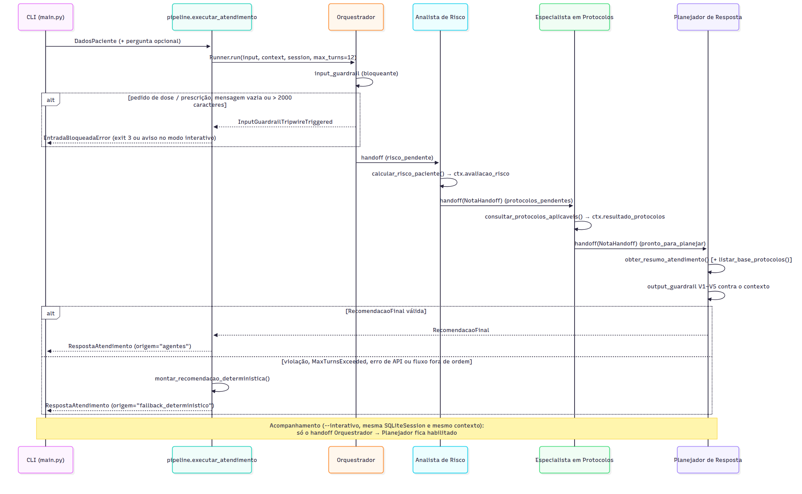

<div class="cabecalho" markdown="1">

<div><strong>CardioIA — Fase 6 "Coração Sob Controle"</strong><br><span class="pequeno">Arquitetura do sistema multiagente · FIAP · Graduação em Inteligência Artificial</span></div>
</div>

# Arquitetura do sistema multiagente


O CardioIA Fase 6 é uma CLI em Python (`src/main.py`) que recebe os dados de um paciente/unidade em JSON e devolve uma recomendação operacional. Quatro agentes do **OpenAI Agents SDK** (`openai-agents==0.24.0`, modelo `gpt-4.1-mini`) trocam o controle por **handoffs** e compartilham um contexto tipado (`ContextoAtendimento`). Quem calcula é sempre o código. A probabilidade vem do Random Forest de `models/modelo_pico_risco.joblib`, a faixa vem de limites fixos (BAIXO < 0,40 ≤ MODERADO < 0,70 ≤ ALTO) e os protocolos saem de regras determinísticas sobre a base simulada P01–P10. O LLM coordena o fluxo e redige as ações operacionais e a explicação. O sistema é acadêmico e informativo (não diagnostica nem prescreve), e o código acrescenta o aviso legal a toda resposta.

Camadas (`src/`): `core` (configuração, erros, logging), `domain` (schemas Pydantic e constantes), `ml` (base sintética e carregamento do modelo), `services` (risco, protocolos, verificação e recomendação determinística), `agentes` (contexto, tools, guardrails, fábricas dos agentes) e `pipeline.py` (execução de um turno, com fallback). `ml` e `services` não importam o SDK (teste `test_arquitetura.py`).

## 1. Agentes

| Agente | Papel | Tools | Handoff de saída |
|---|---|---|---|
| Orquestrador | Coordena. Não calcula nem responde. Tem o input guardrail | — | Analista, Especialista ou Planejador (só um habilitado por etapa) |
| Analista de Risco | Chama a tool do modelo uma vez e resume probabilidade e faixa | `calcular_risco_paciente` | Especialista (`NotaHandoff`) |
| Especialista em Protocolos | Seleciona os protocolos da base; nunca acrescenta outros | `consultar_protocolos_aplicaveis` | Planejador (`NotaHandoff`) |
| Planejador de Resposta | Copia os valores calculados, redige 1–8 ações e a explicação; responde ao acompanhamento | `obter_resumo_atendimento`, `listar_base_protocolos` | — (saída final `RecomendacaoFinal` + output guardrail) |

As tools não recebem parâmetros do LLM: leem e gravam `ctx.context`. Assim o LLM não consegue alterar os números de entrada do modelo. Elas usam `failure_error_function=None`, então uma exceção interrompe a execução em vez de virar texto para o LLM.

## 2. Handoffs, gating e por que o fluxo é forçado por código

Três predicados mutuamente exclusivos controlam o `is_enabled` dos handoffs e das tools: `risco_pendente` (sem avaliação), `protocolos_pendentes` (risco pronto, protocolos não) e `pronto_para_planejar` (os dois prontos). Orquestrador, Analista e Especialista usam `tool_choice="required"`, `parallel_tool_calls=False` e `reset_tool_choice=False`. Depois que a tool do Analista roda, ela some (`is_enabled`), e a única "tool" que sobra é o handoff seguinte. O mesmo vale para o Especialista. O resultado é a cadeia **Orquestrador → Analista → Especialista → Planejador** em todo atendimento novo, sem loops de tool e sem resposta de texto prematura. No acompanhamento, com risco e protocolos já no contexto, só o handoff Orquestrador → Planejador fica habilitado. Se um turno anterior parou depois do risco e antes dos protocolos (por exemplo, por fallback), a retomada habilita só Orquestrador → Especialista.

É uma escolha deliberada de governança em saúde: menos autonomia nos agentes de cálculo em troca de um fluxo previsível e auditável. A alternativa "agentes como tools" (`agent.as_tool`, hub-and-spoke) foi descartada porque não usa handoffs, que o enunciado exige. Os callbacks `on_handoff` registram a `cadeia_agentes` do turno e as `NotaHandoff` (até 300 caracteres), que o Planejador recebe em `obter_resumo_atendimento`.

## 3. Guardrails e validação em camadas

| Camada | O que garante |
|---|---|
| `DadosPaciente` (antes do SDK) | 10 campos obrigatórios, faixas plausíveis, chaves normalizadas (`"disponibilidade recursos"` → `disponibilidade_recursos`), rejeita extras, NaN e booleanos. Erro → exit 1, sem custo de LLM |
| Input guardrail `validar_entrada_atendimento` (bloqueante) | Bloqueia mensagem vazia, acima de 2.000 caracteres ou com pedido de prescrição/dose/posologia/medicamento (regex `PEDIDOS_PRESCRICAO`). Exit 3; no modo interativo mostra o motivo e segue |
| `output_type=RecomendacaoFinal` | Schema estrito (structured outputs): probabilidade em [0, 1], IDs só de P01 a P10, de 1 a 8 ações, explicação de até 1.500 caracteres |
| Output guardrail `validar_recomendacao_final` | V1 probabilidade (tolerância 0,0005), V2 faixa, V3 conjunto de protocolos, V4 duplicados, V5 termo prescritivo em ações/explicação |
| Pipeline | Monta a resposta exibida com os valores do contexto (nunca os digitados pelo LLM) e o aviso legal |

**Fallback determinístico.** Violação do output guardrail, `MaxTurnsExceeded`, `ModelBehaviorError`/recusa, execução terminada fora do Planejador, erro de rede/limite/5xx da OpenAI ou tool chamada fora de ordem: nesses casos o pipeline devolve `montar_recomendacao_deterministica` com `origem="fallback_deterministico"`, `motivo_fallback` e, se houver, `violacoes_guardrail`. A CLI imprime `ORIGEM: fallback_deterministico (motivo)` e sai com 0. Sem chave ou com chave inválida, sai com exit 2. `--sem-llm` executa só os `services` (`origem="sem_llm"`). Um `OPENAI_MODEL` inexistente (`openai.NotFoundError`) não está mapeado e sai com exit 4 ("erro inesperado"): confira a variável no `src/.env`.

## 4. Histórico de mensagens

Cada atendimento usa uma `SQLiteSession(atendimento_id, data/sessoes.db)` passada ao `Runner.run`, e o SDK prepende o histórico a cada turno. No `--interativo`, a mesma sessão e o mesmo contexto são reaproveitados. A pergunta "por que o protocolo de SpO2 não foi acionado?" vai direto ao Planejador, que responde com o histórico e o resumo (SpO2 = 89; P01 só aciona abaixo de 88). A `cadeia_agentes` é reiniciada por turno. As notas e os resultados calculados persistem. O diagrama de sequência de um atendimento, com os ramos de bloqueio e de fallback, está no fim do documento.

## 5. Exemplo real de entrada e saída (`novo_caso` do enunciado)

Entrada: `data/novo_caso.json` (`idade_media` 62, `carga_sistema` 92, `tempo_espera` 75, `fc_media` 118, `spo2_media` 89, `pa_sistolica` 100, `temperatura` 37,5, `densidade_eventos` 7, `eventos_24h` 5, `"disponibilidade recursos"` 25). Saída de `python main.py --json` com a OpenAI (`gpt-4.1-mini`), salva em `docs/fonte/exemplo_execucao.json` (trecho):

```json
{
  "avaliacao_risco": {"probabilidade": 0.99, "classificacao": "ALTO", "pico_risco_previsto": true,
                      "limiar_decisao": 0.5, "modelo_versao": "rf-v1", "avisos": []},
  "protocolos": [
    {"id": "P02", "justificativa": "carga_sistema=92 > 85"},
    {"id": "P05", "justificativa": "disponibilidade_recursos=25 < 30"},
    {"id": "P08", "justificativa": "densidade_eventos=7 > 6"},
    {"id": "P10", "justificativa": "classificacao_risco=ALTO"}],
  "sinais_de_atencao": [{"mensagem": "spo2_media=89 (risco < 92; P01 aciona < 88)"}, "... (+3)"],
  "acoes_operacionais": ["Abrir unidades temporárias devido à carga do sistema elevada (92% > 85%).",
    "Redistribuir insumos por baixa disponibilidade de recursos (25% < 30%).", "... (+3)"],
  "explicacao": "O paciente apresenta risco sistêmico alto com probabilidade prevista de 99% ...",
  "cadeia_agentes": ["Orquestrador", "Analista de Risco", "Especialista em Protocolos", "Planejador de Resposta"],
  "origem": "agentes", "violacoes_guardrail": [], "motivo_fallback": null, "aviso_legal": "Aviso: o CardioIA é ..."
}
```

O log INFO mostra os três handoffs (`handoff -> Analista de Risco`, `-> Especialista em Protocolos`, `-> Planejador de Resposta`). Probabilidade, faixa e protocolos são idênticos aos do `--sem-llm`; o LLM só redigiu ações e explicação. No `--interativo`, a pergunta sobre SpO2 foi respondida só pelo Planejador (cadeia Orquestrador → Planejador), citando 89% contra o gatilho < 88%, e o pedido de dose foi bloqueado pelo input guardrail sem chamar a OpenAI. `pytest -m llm` confere os dois fluxos.

## 6. Divergência com o exemplo de resposta do enunciado

O enunciado mostra, para o `novo_caso`, RISCO PREVISTO 0,91 e os protocolos P01, P02 e P05. O RF treinado devolve 0,99, e o sistema devolve **P02, P05, P08 e P10** porque aplica a base com comparação estrita:

- **P01 não aciona:** SpO2 = 89 e o gatilho é SpO2 < 88. O valor aparece como sinal de atenção, porque já está abaixo de 92, o limiar de risco do alvo.
- **P08 aciona:** `densidade_eventos` = 7 > 6.
- **P10 aciona:** a classificação é ALTO (p = 0,99 ≥ 0,70), e definimos "risco sistêmico alto" ⇔ ALTO.

Tratamos o exemplo do enunciado como ilustração de formato. Deixar o LLM escolher os protocolos seria menos auditável, não reprodutível e poderia copiar o exemplo. O output guardrail (V3) rejeita qualquer conjunto diferente do calculado.

## 7. Detalhes de implementação

- `RespostaAtendimento.motivo_fallback` (opcional, `null` fora do fallback) aparece no `--json` e em `exemplo_execucao.json`.
- `agentes/instrucoes.py` reúne o `RECOMMENDED_PROMPT_PREFIX`, a regra de escopo comum e o `ModelSettings` (sem `temperature` se `OPENAI_TEMPERATURE` estiver vazio).
- Os predicados de gating ficam em `agentes/contexto.py` (sem SDK) e são reexportados por `agentes/orquestrador.py`, para tools e handoffs usarem a mesma fonte sem import circular.

<div class="figura" style="--altura: 66mm"></div>

<p class="pequeno" style="text-align: center">Diagramas em resolução completa: <code>assets/arquitetura_multiagente.png</code> e <code>assets/sequencia_atendimento.png</code>.</p>
