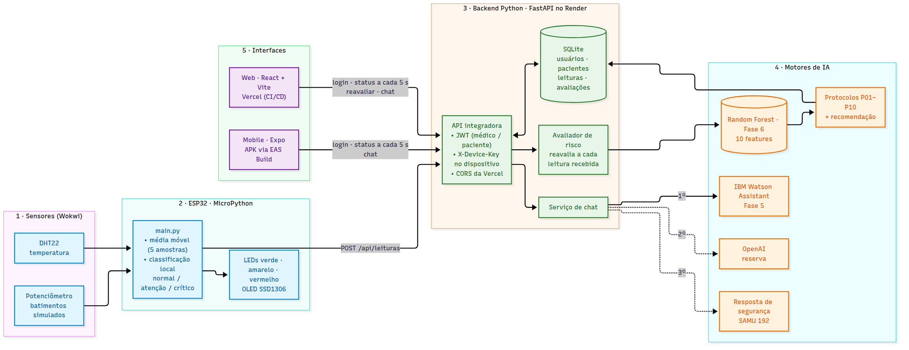

# FIAP - Faculdade de Informática e Administração Paulista

<p align="center">
<a href= "https://www.fiap.com.br/"></a>
</p>

<br>

# CardioIA: A Nova Era da Cardiologia Inteligente

**Fase 7 — "Coração Sob Controle": plataforma integrada de previsão de crises com IA**

## 🔗 Links da entrega

| Entregável | Link |
|---|---|
| Aplicação Web (Vercel) | [https://tiao-2026.vercel.app](https://tiao-2026.vercel.app) |
| APK Android (Expo / EAS Build) | [Build no dashboard do Expo (download e QR Code)](https://expo.dev/accounts/microdri/projects/cardioia/builds/182ecc37-8deb-4059-8612-1fac1bcf6171) |
| API integradora (Render) | [https://cardioia-backend-phkq.onrender.com](https://cardioia-backend-phkq.onrender.com/api/health) |
| Simulação Wokwi (MicroPython) | _a adicionar: link público do projeto_ |
| Relatório técnico (PDF) | [`docs/relatorio_fase7.pdf`](docs/relatorio_fase7.pdf) |
| Vídeo demonstrativo | [https://youtu.be/OtVBNq8AOJ8](https://youtu.be/OtVBNq8AOJ8) |

## 👨‍🎓 Integrantes:
- <a href="https://www.linkedin.com/in/michaelrodriguess/">Michael Rodrigues</a>
- <a href="https://www.linkedin.com/in/arthur-alentejo/">Arthur Alentejo</a>
- <a href="https://www.linkedin.com/in/nathalia-vasconcelos-18a390292/">Nathalia Vasconcelos</a>

## 👩‍🏫 Professores:
### Tutor(a)
- <a href="#">Caique (CaiqueFiap-2026)</a>
### Coordenador(a)
- <a href="https://www.linkedin.com/in/andregodoichiovato/">André Godói</a>

## 📜 Descrição

Na Fase 7, a CardioIA deixa de ser um conjunto de módulos isolados e vira uma plataforma única. Um dispositivo simulado no Wokwi mede temperatura e batimentos, classifica o estado do paciente localmente em MicroPython e envia as leituras para um backend em Python. O backend guarda as leituras, recalcula o risco com o modelo preditivo da Fase 6 e responde ao chat com o assistente da Fase 5. Médico e paciente acompanham tudo em tempo real pela aplicação Web, publicada na Vercel, e pelo aplicativo Android, distribuído como APK pelo EAS Build.

> ⚠️ **Aviso.** Sistema acadêmico e informativo, com dados sintéticos. Não realiza diagnóstico, não prescreve tratamentos e não substitui a avaliação de um profissional de saúde.

## 🧩 Arquitetura final

<p align="center"></p>

Fonte do diagrama: [`document/fonte/arquitetura_final.mmd`](document/fonte/arquitetura_final.mmd).

**Fluxo de uma leitura, de ponta a ponta:**

1. **Sensor (Wokwi):** o DHT22 mede a temperatura, e um potenciômetro simula a frequência cardíaca.
2. **MicroPython (ESP32):** o firmware suaviza os batimentos com média móvel de 5 amostras, classifica o estado como normal, atenção ou crítico, acende o LED correspondente, mostra os valores no OLED e envia `POST /api/leituras` com o header `X-Device-Key`, a cada 5 s.
3. **Backend Python (FastAPI no Render):** valida a chave do dispositivo e grava a leitura no SQLite e reavalia o risco na hora, a cada leitura. Assim o risco sobe numa crise e volta a baixar quando o sinal normaliza.
4. **APIs de IA:** o Random Forest da Fase 6 calcula a probabilidade de pico de risco a partir de 10 indicadores, e as regras P01–P10 selecionam os protocolos e as ações. O chat usa o IBM Watson Assistant da Fase 5, com o OpenAI como reserva e uma resposta de segurança fixa quando nenhum dos dois responde.
5. **UI (Web e APK):** as telas consultam o status do paciente a cada 5 s e mostram o medidor de risco, os sinais vitais com gráfico, os protocolos acionados, as ações sugeridas e o chat.

## 🖥️ Aplicações

| Camada | Tecnologia | Pasta | Deploy |
|---|---|---|---|
| Web | React 19 + Vite + TypeScript | [`web/`](web/) | Vercel, com deploy automático a cada push na `main` |
| Mobile | React Native + Expo SDK 58 (Expo Router) | [`mobile/`](mobile/) | APK pelo EAS Build (perfil `preview`) |
| Backend | FastAPI + SQLite + modelo da Fase 6 | [`backend/`](backend/) | Render (`render.yaml`) |
| IoT | MicroPython no ESP32 (Wokwi) | [`iot/`](iot/) | Simulação pública no Wokwi |

**Contas de demonstração** (senha `cardioia`):

| Perfil | E-mail | O que vê |
|---|---|---|
| Médico | `medico@cardioia.com` | Todos os pacientes, ordenados por risco, com reavaliação manual e os indicadores do modelo |
| Paciente | `paciente@cardioia.com` | Só o próprio painel e o chat |

## 📱 Instalação do APK

1. No celular Android, abra o link do build na tabela de links (ou leia o QR Code da página do build) e toque em **Install** para baixar o `.apk`.
2. Quando o Android pedir, permita a instalação de apps de fontes desconhecidas para o navegador.
3. Abra o **CardioIA**, entre com uma das contas de demonstração e abra o painel do paciente.

A primeira chamada pode levar até um minuto: o plano gratuito do Render desliga o backend depois de um tempo sem uso. O app mostra o aviso "O servidor está iniciando" enquanto isso.

## 🚀 Deploy e CI/CD

| Item | Configuração |
|---|---|
| Web na Vercel | Root Directory `2TIAO/FASE7-CARDIOIA/web`. O [`vercel.json`](web/vercel.json) reescreve todas as rotas para `index.html` (rotas SPA). Cada push na `main` publica a produção. Variável: `VITE_API_URL`. |
| APK no EAS | [`app.json`](mobile/app.json) com `android.package: "br.com.fiap.cardioia"`. [`eas.json`](mobile/eas.json) com o perfil `preview` e `android.buildType: "apk"`. Build: `npx eas-cli@latest build -p android --profile preview`. Variável: `EXPO_PUBLIC_API_URL`. |
| Backend no Render | Root Directory `2TIAO/FASE7-CARDIOIA/backend`, conforme o [`render.yaml`](backend/render.yaml). Variáveis: `JWT_SECRET`, `DEVICE_KEY`, `CORS_ORIGINS` e as credenciais do Watson e do OpenAI. |
| Verificação contínua | O workflow [`fase7-cardioia.yml`](../../.github/workflows/fase7-cardioia.yml) roda lint e build do web e typecheck, lint, `expo-doctor` e bundle Android do mobile a cada push e PR. |

### Evidências do deploy

| Evidência | Print |
|---|---|
| Deploys automáticos na Vercel | [`assets/prints/vercel_deployments.png`](assets/prints/vercel_deployments.png) |
| Workflow verde no GitHub Actions | [`assets/prints/github_actions.png`](assets/prints/github_actions.png) |
| Build concluído no Expo | [`assets/prints/expo_build.png`](assets/prints/expo_build.png) |
| APK instalado: login | [`assets/prints/apk_login.png`](assets/prints/apk_login.png) |
| APK instalado: painel do paciente | [`assets/prints/apk_painel.png`](assets/prints/apk_painel.png) |
| Painel Web com dados do Wokwi | [`assets/prints/web_painel.png`](assets/prints/web_painel.png) |

## 🔌 IoT em MicroPython (Wokwi)

O firmware em C/C++ da Fase 3 foi reescrito em MicroPython ([`iot/main.py`](iot/main.py)). A comparação entre as duas versões está em [`document/conversao_c_micropython.md`](document/conversao_c_micropython.md).

| Componente | Pino do ESP32 | Função |
|---|---|---|
| DHT22 | GPIO 15 | Temperatura (inicia em 36,6 °C na simulação) |
| Potenciômetro | GPIO 34 (ADC) | Frequência cardíaca simulada, de 40 a 180 bpm |
| LEDs verde, amarelo e vermelho | GPIO 4, 17 e 16 | Estado local: normal, atenção ou crítico |
| OLED SSD1306 | GPIO 21 (SDA) e 22 (SCL) | FC média, temperatura e estado |

**Classificação local no dispositivo:**

| Estado | Regra |
|---|---|
| Crítico | FC < 50 ou FC > 120 bpm, ou temperatura > 38 °C |
| Atenção | FC entre 50 e 59 ou entre 101 e 120 bpm, ou temperatura entre 37,5 e 38 °C |
| Normal | demais casos |

Para rodar: abra o link do Wokwi, ajuste `API_URL` e `DEVICE_KEY` em `main.py` com a URL do backend e a mesma chave configurada no Render, e inicie a simulação. Gire o potenciômetro para mudar os batimentos ou clique no DHT22 para mudar a temperatura. Em até 5 s a leitura chega ao painel Web e ao app.

## 🧠 Motores de IA

- **Modelo preditivo (Fase 6):** Random Forest com 200 árvores, treinado com 10 indicadores clínicos e operacionais. No teste da Fase 6: acurácia 0,999 e F1 0,998 para a classe de pico. As faixas são BAIXO (< 0,40), MODERADO (0,40 a 0,70) e ALTO (≥ 0,70). O backend monta as 10 features combinando a média das 5 leituras mais recentes do sensor (FC, SpO₂ e temperatura) com os indicadores operacionais simulados de cada paciente.
- **Protocolos e recomendação (Fase 6):** as regras P01–P10 escolhem os protocolos acionados, os sinais de atenção e as ações operacionais. A resposta segue o mesmo schema da Fase 6 (`RespostaAtendimento`).
- **Chat (Fase 5):** o IBM Watson Assistant faz a triagem conversacional, reaproveitando a sessão entre mensagens. Se o Watson falhar, o OpenAI responde com instruções que proíbem diagnóstico e prescrição. Se nenhum dos dois estiver disponível, o sistema devolve uma orientação fixa de emergência (SAMU 192).

## 🔧 Como executar localmente

```bash
# Backend (http://localhost:8000/docs)
cd 2TIAO/FASE7-CARDIOIA/backend
python -m venv .venv && source .venv/bin/activate
pip install -r requirements.txt
cp .env.example .env            # defina DEVICE_KEY e, se tiver, as chaves do Watson/OpenAI
uvicorn app.main:app --reload
pytest                          # testes da API

# Web (http://localhost:5173)
cd 2TIAO/FASE7-CARDIOIA/web
npm install
echo "VITE_API_URL=http://localhost:8000" > .env.local
npm run dev

# Mobile (Expo Go ou emulador)
cd 2TIAO/FASE7-CARDIOIA/mobile
npm install
npx expo start
```

Sem a URL do backend configurada, o Web e o app entram em **modo demonstração**, com dados simulados no próprio aparelho, e mostram esse aviso na tela.

Detalhes de cada parte: [`backend/README.md`](backend/README.md), [`web/README.md`](web/README.md), [`mobile/README.md`](mobile/README.md) e o contrato da API em [`document/contrato_api.md`](document/contrato_api.md).

## 📁 Estrutura de pastas

```
FASE7-CARDIOIA/
├── assets/                 # logo, diagrama de arquitetura e prints do deploy
├── backend/                # FastAPI + SQLite + motores de IA
│   ├── app/                # rotas, autenticação, banco e avaliador de risco
│   ├── cardioia/           # modelo, protocolos e recomendação reaproveitados da Fase 6
│   ├── models/             # modelo_pico_risco.joblib + metadados
│   ├── services/           # chat (Watson → OpenAI → resposta de segurança)
│   ├── tests/
│   └── render.yaml
├── docs/                   # relatório técnico em PDF
├── document/               # contrato da API, conversão C/C++ → MicroPython, fontes do diagrama
├── iot/                    # main.py (MicroPython), driver do OLED e diagram.json do Wokwi
├── mobile/                 # app Expo (app.json, eas.json)
├── web/                    # app React + Vite (vercel.json)
└── README.md
```

## 🧭 Decisões e limitações

- **Avaliação em tempo real sem LLM:** a reavaliação automática usa o modelo e as regras da Fase 6 diretamente. O pipeline com agentes da Fase 6 levaria vários segundos e teria custo por chamada a cada leitura do sensor. O LLM fica no chat, onde a conversa justifica a latência.
- **Atualização por polling:** as telas consultam o backend a cada 5 s. É mais simples e confiável que WebSocket no plano gratuito do Render, e o intervalo coincide com o envio do sensor.
- **HTTP no lugar de MQTT:** o dispositivo envia direto para a API, sem broker intermediário. Isso elimina um serviço externo e permite reavaliar o risco no mesmo request.
- **Dados sintéticos e simulados:** temperatura e batimentos vêm de componentes virtuais do Wokwi, e a SpO₂ é fixa em 97 %. Os demais indicadores do modelo são valores operacionais simulados por paciente.
- **Persistência temporária:** o disco do Render gratuito é apagado quando o serviço reinicia. O banco é recriado com os pacientes e as contas de demonstração.

## 📋 Licença

<p xmlns:cc="http://creativecommons.org/ns#" xmlns:dct="http://purl.org/dc/terms/"><a property="dct:title" rel="cc:attributionURL" href="https://github.com/agodoi/template">MODELO GIT FIAP</a> por <a rel="cc:attributionURL dct:creator" property="cc:attributionName" href="https://fiap.com.br">Fiap</a> está licenciado sobre <a href="http://creativecommons.org/licenses/by/4.0/?ref=chooser-v1" target="_blank" rel="license noopener noreferrer" style="display:inline-block;">Attribution 4.0 International</a>.</p>
